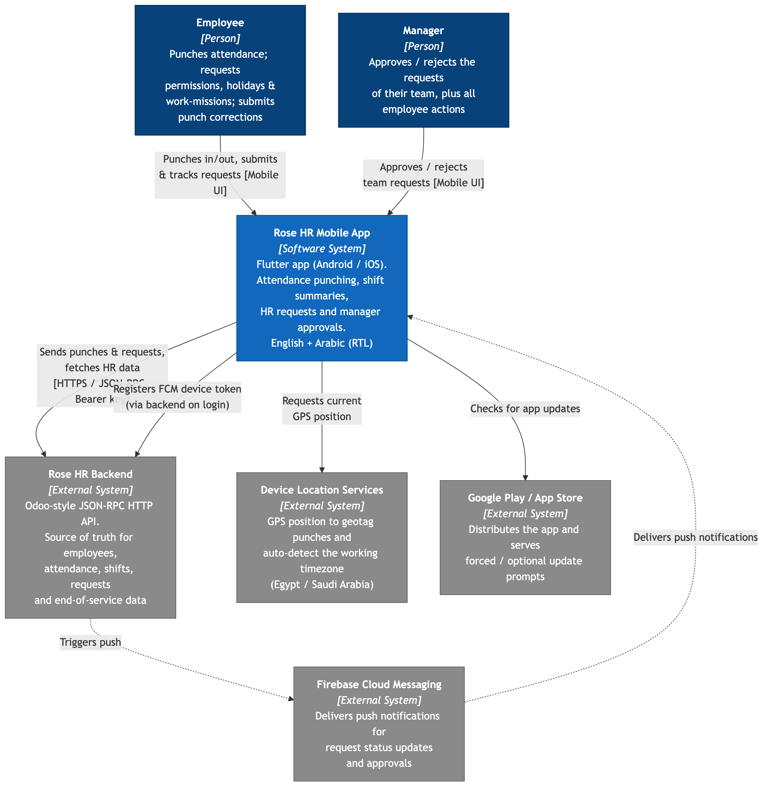
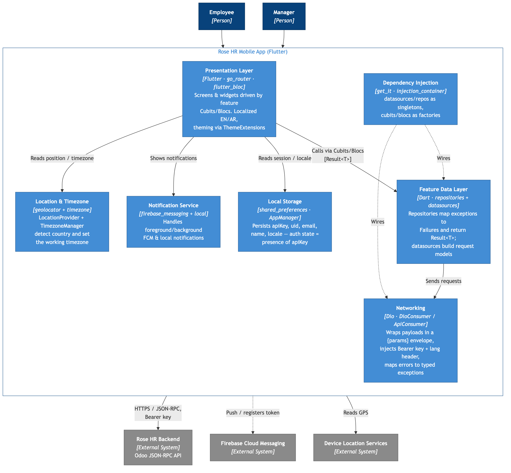
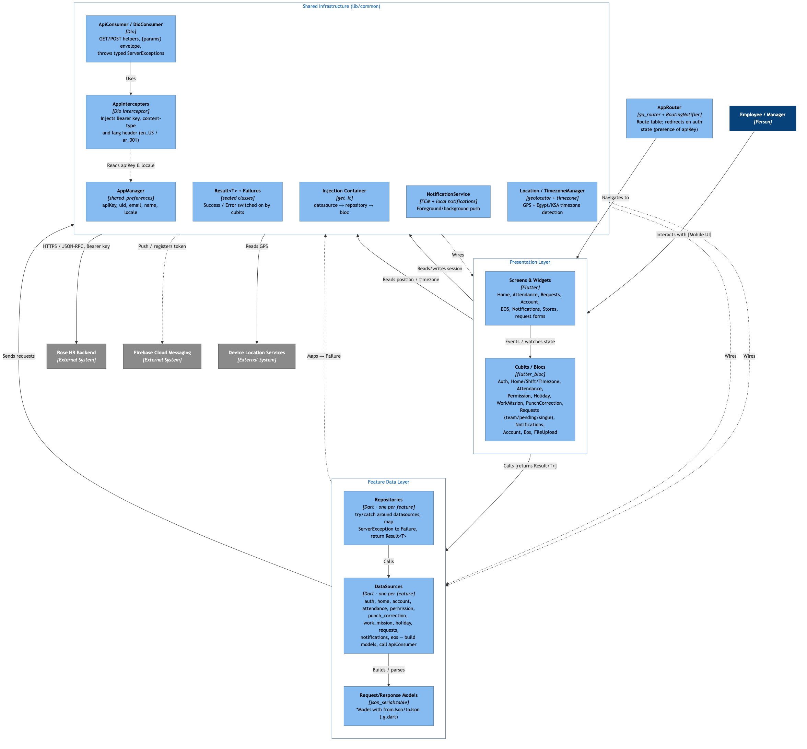

# Rose HR — C4 Architecture Model

C4 diagrams for the `rose_hr` Flutter app, following the
[C4 model](https://c4model.com/) (Context → Container → Component).

Each diagram is authored as a Mermaid `.mmd` source file and rendered to
**SVG** (vector, best for docs/print) and **PNG** (3× raster, best for slides).

| Level | Source | Exports |
|-------|--------|---------|
| **1 — System Context** — the app, its users and the external systems it talks to | [`c4-context.mmd`](c4-context.mmd) | [SVG](c4-context.svg) · [PNG](c4-context.png) |
| **2 — Container** — the major runtime building blocks inside the app | [`c4-container.mmd`](c4-container.mmd) | [SVG](c4-container.svg) · [PNG](c4-container.png) |
| **3 — Component** — the clean-architecture-lite components (presentation / data / shared) | [`c4-component.mmd`](c4-component.mmd) | [SVG](c4-component.svg) · [PNG](c4-component.png) |

## Diagrams

### System Context


### Container


### Component


## Legend

| Colour | Meaning |
|--------|---------|
| Dark blue | Person (Employee / Manager) |
| Blue | The Rose HR software system |
| Medium blue | Container (a deployable/runtime block inside the app) |
| Light blue | Component (a grouping of code inside a container) |
| Grey | External system (backend, Firebase, OS services, app stores) |

## Regenerating / exporting

The diagrams are rendered with [`@mermaid-js/mermaid-cli`](https://github.com/mermaid-js/mermaid-cli)
(no global install needed — `npx` fetches it):

```bash
cd docs/c4

# one file, to SVG and to 3x PNG
npx -y @mermaid-js/mermaid-cli -i c4-context.mmd -o c4-context.svg
npx -y @mermaid-js/mermaid-cli -i c4-context.mmd -o c4-context.png -s 3

# export to PDF instead
npx -y @mermaid-js/mermaid-cli -i c4-context.mmd -o c4-context.pdf
```

Regenerate all three at once:

```bash
for f in c4-context c4-container c4-component; do
  npx -y @mermaid-js/mermaid-cli -i "$f.mmd" -o "$f.svg"
  npx -y @mermaid-js/mermaid-cli -i "$f.mmd" -o "$f.png" -s 3
done
```

You can also paste any `.mmd` file into <https://mermaid.live> to edit it
visually and export PNG/SVG/PDF from there.

> Note: the diagrams use Mermaid **flowchart** syntax styled to match the C4
> visual language, rather than Mermaid's native `C4Context`/`C4Component`
> blocks, because the flowchart auto-layout is far cleaner for a graph this size.
